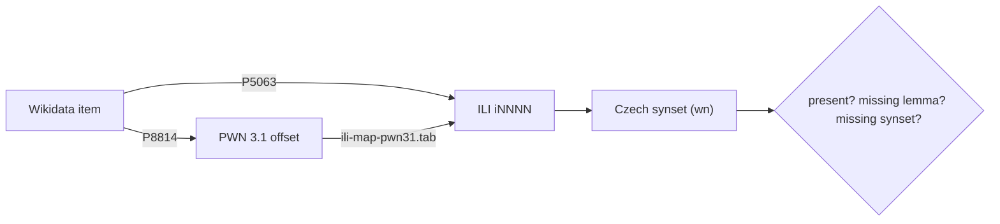

# Wikidata → ILI → Czech, as a literate program

This is the **source** for `wikidata_to_czech.py`. Edit the prose and code here,
then regenerate the script:

```bash
uv run tangle.py wikidata.lit.md     # writes wikidata_to_czech.py
uv run wikidata_to_czech.py 500      # run it
```

The goal (project 5): find concepts that Wikidata links to a wordnet synset and
labels in Czech, then ask whether the Czech wordnet already has them. The ones
it lacks are ranked candidates to add.

## The bridge

Everything hinges on reaching a shared key. The Czech wordnet is keyed to
**ILI** (the Collaborative Interlingual Index), so we need each Wikidata item's
ILI. Two Wikidata properties get us there:

- **P5063** "Interlingual Index ID" — *is* the ILI (`i46360`). Fewer items carry
  it (~20k), but it needs no mapping.
- **P8814** "WordNet 3.1 Synset ID" — a WordNet **3.1** offset (`02086723-n`).
  More items (~35k), but we must map it to an ILI through the CILI table
  `ili-map-pwn31.tab`. Mapping through `omw-en:2.0` would fail: that is WordNet
  **3.0**, whose offsets differ.

We prefer P5063 and fall back to P8814 → CILI, which reaches the most items.



## Assembling the script

The whole program is six pieces, read top to bottom:

```python {file=wikidata_to_czech.py}
<<script-header>>
<<imports-and-config>>


<<load-the-cili-map>>


<<query-wikidata>>


<<classify-and-report>>


<<entry-point>>
```

The header declares the dependencies inline, so `uv run` fetches them. A short
docstring points back here, because this file is generated.

```python {#script-header}
#!/usr/bin/env python3
# /// script
# requires-python = ">=3.10"
# dependencies = ["wn>=1.1", "requests"]
# ///
"""Wikidata -> ILI -> Czech (project 5).

Tangled from wikidata.lit.md -- edit the prose there, not this file.
"""
```

## Configuration

We share one `wn` database with the other projects (`patterns/.wn_data`), send a
real User-Agent to the Wikidata Query Service, and cache the CILI table beside
this script.

```python {#imports-and-config}
import sys
from pathlib import Path

import requests
import wn

HERE = Path(__file__).resolve().parent
wn.config.data_directory = HERE.parent / "patterns" / ".wn_data"   # share one DB
WDQS = "https://query.wikidata.org/sparql"
UA = "JPC3-course/0.1 (https://github.com/omwn; bond@ieee.org)"
CILI_URL = ("https://raw.githubusercontent.com/globalwordnet/cili/"
            "master/ili-map-pwn31.tab")
CILI_TAB = HERE / "ili-map-pwn31.tab"
```

## The CILI map

The table has two columns: an ILI and a PWN 3.1 id. We invert it to look up
*offset → ILI*, downloading once and caching.

```python {#load-the-cili-map}
def load_cili() -> dict[str, str]:
    """{ '02086723-n': 'i46360', ... } mapping PWN 3.1 ids to ILIs."""
    if not CILI_TAB.exists():
        CILI_TAB.write_bytes(requests.get(CILI_URL, timeout=120).content)
    mapping = {}
    for line in CILI_TAB.read_text(encoding="utf-8").splitlines():
        if "\t" in line:
            ili, pwn = line.split("\t", 1)
            mapping[pwn.strip()] = ili.strip()
    return mapping
```

## Querying Wikidata

One SPARQL query gets both properties via `UNION`, plus the Czech label. An item
with both properties returns two rows, so we fold them into one record per item,
keeping whichever of `ili` / `wn` each row carries.

```python {#query-wikidata}
def fetch(limit: int) -> dict[str, dict]:
    """Return {qid: {'label', 'ili', 'wn'}} for items with P5063 or P8814."""
    query = f"""
    SELECT ?item ?cs ?ili ?wn WHERE {{
      {{ ?item wdt:P5063 ?ili . }} UNION {{ ?item wdt:P8814 ?wn . }}
      ?item rdfs:label ?cs . FILTER(lang(?cs) = "cs")
    }} LIMIT {limit}
    """
    r = requests.get(WDQS, params={"query": query, "format": "json"},
                     headers={"User-Agent": UA}, timeout=120)
    r.raise_for_status()
    items: dict[str, dict] = {}
    for b in r.json()["results"]["bindings"]:
        qid = b["item"]["value"].rsplit("/", 1)[-1]
        rec = items.setdefault(qid, {"label": b["cs"]["value"],
                                     "ili": None, "wn": None})
        if "ili" in b:
            rec["ili"] = b["ili"]["value"]      # P5063, e.g. i46360
        if "wn" in b:
            rec["wn"] = b["wn"]["value"]        # P8814, e.g. 02086723-n
    return items
```

## Classifying each item

For each item we resolve an ILI (P5063 first, else P8814 → CILI), look up the
Czech synset, and label it: already **present**, a **missing lemma** on a synset
that exists, a **missing synset** entirely, or **no-ili** if we could not bridge
it. The candidates are the two `missing-*` classes.

```python {#classify-and-report}
def main() -> None:
    limit = int(sys.argv[1]) if len(sys.argv) > 1 else 500
    out = Path(sys.argv[2]) if len(sys.argv) > 2 else None

    pwn31_to_ili = load_cili()
    cs = wn.Wordnet(lexicon="ntumc-cs:2026.08")

    items = fetch(limit)
    counts = {"present": 0, "missing-lemma": 0, "missing-synset": 0, "no-ili": 0}
    records = []
    for qid, rec in items.items():
        label = rec["label"]
        ili = rec["ili"] or pwn31_to_ili.get(rec["wn"])   # prefer P5063
        wnid = rec["wn"] or ""
        if not ili:
            kind, cs_lemmas = "no-ili", []
        else:
            cs_syns = cs.synsets(ili=ili)
            cs_lemmas = [w.lemma() for s in cs_syns for w in s.words()]
            if not cs_syns:
                kind = "missing-synset"
            elif label in cs_lemmas:
                kind = "present"
            else:
                kind = "missing-lemma"
        counts[kind] += 1
        records.append((kind, qid, wnid, ili or "", label, "|".join(cs_lemmas)))

    print(f"{len(items)} Wikidata items with P5063/P8814 + a Czech label")
    for k, v in counts.items():
        print(f"  {k:15}: {v}")
    print("\ncandidate additions (missing-lemma / missing-synset), first 15:")
    for rec in [r for r in records if r[0].startswith("missing")][:15]:
        kind, qid, wnid, ili, label, lemmas = rec
        print(f"  {kind:14} {label!r:24} ili={ili:9} cs=[{lemmas}]")

    if out:
        with out.open("w", encoding="utf-8") as fh:
            fh.write("kind\tqid\twn31\tili\twikidata_cs\tczech_lemmas\n")
            for rec in records:
                fh.write("\t".join(rec) + "\n")
        print(f"\nwrote {len(records)} rows to {out}")
```

## Entry point

```python {#entry-point}
if __name__ == "__main__":
    main()
```
